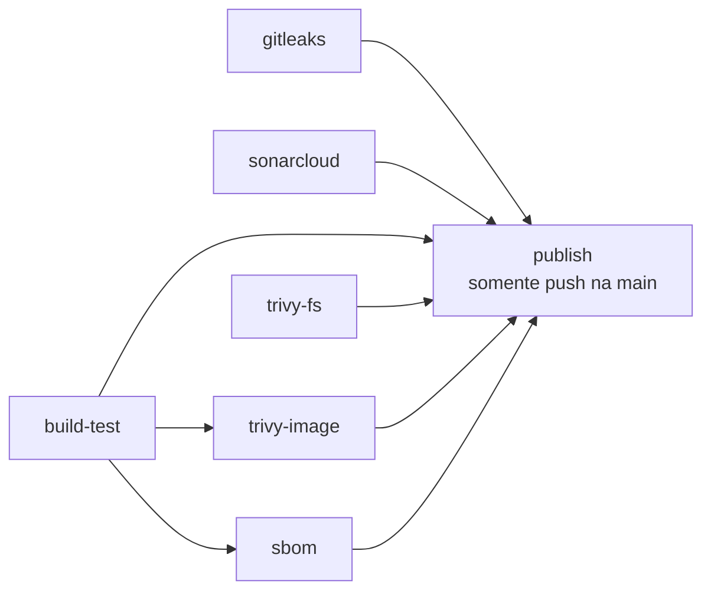

# Exercício DevOps com FastAPI — Pipeline DevSecOps

Aplicação simples em FastAPI com o endpoint `GET /hello`, protegida por um pipeline de CI/CD com segurança integrada (DevSecOps, *shift-left security*) usando GitHub Actions.

Antes de qualquer alteração chegar à branch `main`, o pipeline procura segredos vazados, falhas de código, vulnerabilidades em dependências e na imagem Docker, e gera o inventário de componentes (SBOM). A imagem só é publicada no Docker Hub se **todas** as verificações obrigatórias passarem.

## Sumário

- [Visão geral do pipeline](#visão-geral-do-pipeline)
- [Ferramentas e regras de bloqueio](#ferramentas-e-regras-de-bloqueio)
- [Publicação da imagem](#publicação-da-imagem)
- [Proteção da branch main](#proteção-da-branch-main)
- [Demonstração de bloqueio e correção](#demonstração-de-bloqueio-e-correção)
- [Primeiro achado real do Trivy](#primeiro-achado-real-do-trivy)
- [Configuração necessária](#configuração-necessária)
- [Decisões e limitações](#decisões-e-limitações)
- [Mapa dos entregáveis](#mapa-dos-entregáveis)
- [Desenvolvimento local](#desenvolvimento-local)

## Visão geral do pipeline

Todo o pipeline está em um único workflow, [`.github/workflows/ci.yml`](.github/workflows/ci.yml). Ele foi unificado de propósito: no GitHub Actions, a palavra-chave `needs` só funciona entre jobs do mesmo workflow, e a publicação precisa depender das verificações.

**Gatilhos:** abertura e atualização de Pull Requests, push na `main` e execução manual (`workflow_dispatch`).



| Job | Ferramenta | O que faz | Bloqueia? |
|---|---|---|---|
| `gitleaks` | Gitleaks | Detecta segredos nos commits | Sim |
| `sonarcloud` | SonarCloud | Testes, cobertura, análise estática (SAST) e Quality Gate | Sim |
| `build-test` | Docker | Constrói a imagem uma única vez e testa o `/hello` em um container | Sim |
| `trivy-fs` | Trivy | Varre as dependências do projeto | Sim (CRITICAL/HIGH com correção) |
| `trivy-image` | Trivy | Varre a imagem Docker construída | Sim (CRITICAL/HIGH com correção) |
| `sbom` | Syft | Gera o SBOM da imagem e publica como artifact | Sim (o job precisa concluir) |
| `publish` | Docker Hub | Publica a imagem já verificada | Depende dos seis jobs acima |

A imagem é construída **uma vez** no `build-test` e exportada como artifact temporário (`docker-image`, retenção de 1 dia). Os jobs `trivy-image`, `sbom` e `publish` carregam essa mesma imagem. Assim, o que foi analisado é exatamente o que é publicado.

## Ferramentas e regras de bloqueio

### 1. Gitleaks — detecção de segredos

- **Action:** `gitleaks/gitleaks-action@v2`, com `fetch-depth: 0` no checkout para ter o histórico disponível.
- **Quando executa:** em todo Pull Request e em push na `main`.
- **Regra de bloqueio:** qualquer possível segredo (tokens, chaves, senhas) encontrado nos commits faz o job falhar.
- **Observação importante:** apagar o arquivo em um commit novo **não** resolve, porque o segredo continua no histórico do PR. É preciso remover o commit que o introduziu (reescrevendo a branch) e, num caso real, **revogar** a credencial.
- **Teste:** feito apenas com um token inventado, sem valor real, em uma branch descartável.

Verificação local de todo o histórico (opcional):

```bash
docker run --rm -v "$(pwd):/repo" zricethezav/gitleaks:latest detect --source /repo --verbose
```

### 2. SonarCloud — análise estática (SAST) e Quality Gate

- **Action:** `SonarSource/sonarqube-scan-action@v4`.
- **Configuração:** [`sonar-project.properties`](sonar-project.properties), com `sonar.qualitygate.wait=true`. Esse parâmetro faz o job **aguardar** o resultado do Quality Gate e **falhar** se ele reprovar.
- **Cobertura:** o job roda `pytest --cov=app` e envia o `coverage.xml` ao SonarCloud.
- **Quality Gate:** personalizado, aplicado ao **código novo** (*New Code*). Assim, problemas antigos não travam o time, e o que é introduzido em cada PR precisa atender aos critérios:

| Métrica (código novo) | O gate falha quando |
|---|---|
| Cobertura (Coverage) | menor que 80% |
| Linhas duplicadas (%) | maior que 3% |
| Security Hotspots revisados | menor que 100% |
| Vulnerabilidades | maior que 0 |
| Bugs | maior que 0 |

- **Teste:** um PR adicionou uma função nova sem testes (cobertura do código novo em 0%), e o job falhou. Depois, os testes foram adicionados e o job passou.
- **Pré-requisito no SonarCloud:** a *Automatic Analysis* precisa estar **desativada** (Administration → Analysis Method), pois ela não pode coexistir com a análise via CI.

### 3. Trivy — dependências e imagem Docker

- **Action:** `aquasecurity/trivy-action@v0.36.0`, com `scanners: vuln`.
- **Alvos:** `trivy-fs` varre o repositório (dependências); `trivy-image` varre a imagem Docker construída, incluindo os pacotes do sistema operacional e as bibliotecas Python realmente instaladas.

| Severidade | Comportamento | Detalhes |
|---|---|---|
| **CRITICAL** e **HIGH** | **Bloqueia** (`exit-code: 1`) | Somente vulnerabilidades **com correção disponível** (`ignore-unfixed: true`) |
| **LOW** e **MEDIUM** | **Não bloqueia** (`exit-code: 0`) | Registradas em relatório publicado como artifact |

Em cada job, o passo do relatório (LOW/MEDIUM) roda **antes** do passo bloqueante, e o upload do relatório usa `if: always()`. Assim o relatório é publicado mesmo quando o job falha.

**Artifacts gerados:** `trivy-fs-report` e `trivy-image-report`.

**Por que `ignore-unfixed`:** uma vulnerabilidade sem versão corrigida não pode ser resolvida apenas parando o build. Nesses casos é preciso avaliar a exposição, atualizar a imagem base, aplicar uma mitigação ou registrar uma exceção com prazo.

### 4. Syft — SBOM

- **Action:** `anchore/sbom-action@v0.24.3`, que utiliza o Syft.
- **Alvo:** a imagem Docker construída no pipeline.
- **Formato:** SPDX JSON (`sbom.spdx.json`), com todos os componentes e suas versões (pacotes do Debian e bibliotecas Python).
- **Onde encontrar:** aba **Actions** → execução do workflow **CI** → seção **Artifacts**, no final da página → artifact `sbom-spdx` (baixado como `.zip`).
- **Resumo no log:** o job imprime o total de componentes e a lista de pacotes Python com versão.

O SBOM é um inventário: ele **não** procura vulnerabilidades (isso é papel do Trivy) e não bloqueia nada. Serve para saber de que a imagem é feita, e verificar rapidamente se uma CVE nova atinge uma versão já publicada.

## Publicação da imagem

O job `publish` roda **somente** se:

1. Os seis jobs de verificação (`gitleaks`, `sonarcloud`, `build-test`, `trivy-fs`, `trivy-image`, `sbom`) terminaram com sucesso (`needs`); e
2. O evento é um **push na `main`** (`if: github.event_name == 'push' && github.ref == 'refs/heads/main'`).

Consequências:

- Em **Pull Request**, o `publish` aparece como *skipped*. Uma versão vulnerável testada em PR nunca chega ao Docker Hub.
- Se qualquer verificação falhar, o `publish` é pulado automaticamente.
- O job não reconstrói a imagem: ele carrega a que foi verificada, e a publica com duas tags:

```
SEU_USUARIO/minha-aplicacao:2.0
SEU_USUARIO/minha-aplicacao:<sha-do-commit>
```

## Proteção da branch main

Configurada com um **Ruleset** (Settings → Rules → Rulesets), chamado `protecao-main`, com status **Active**, aplicado à branch padrão:

| Regra | Valor |
|---|---|
| Restrict deletions | ativada |
| Block force pushes | ativada |
| Require a pull request before merging | ativada, com 0 aprovações (repositório de um único autor) |
| Require status checks to pass | `gitleaks`, `sonarcloud`, `build-test`, `trivy-fs`, `trivy-image`, `sbom` |
| Lista de bypass | **vazia**, ninguém ignora as regras |

O job `publish` **não** é um check obrigatório, porque ele nunca executa em Pull Request e travaria todos os merges.

Resultado: o push direto na `main` é rejeitado, e o botão de merge de um PR fica desabilitado enquanto algum check obrigatório estiver vermelho.

## Demonstração de bloqueio e correção

O enunciado exige provar que o pipeline **falha** diante de uma vulnerabilidade e **passa** depois da correção, sem desativar nenhum gate.

**1. Bloqueio** — Branch `test/dependencia-vulneravel`, partindo da `main`:

- Foi acrescentada ao `requirements.txt` a dependência `certifi==2023.5.7`, que possui vulnerabilidades conhecidas com correção disponível (entre elas **CVE-2023-37920** e **CVE-2024-39689**).
- Ao abrir o Pull Request, os checks `trivy-fs` e `trivy-image` falharam, o `publish` foi pulado e o merge ficou bloqueado pelo ruleset.
- O log do Trivy lista o pacote, o CVE, a severidade, a versão instalada e a versão corrigida.

**2. Correção** — no mesmo PR, `certifi` foi atualizado para `2026.10.23`:

- Todos os checks obrigatórios passaram e o merge foi liberado.
- O PR foi encerrado sem merge, pois a dependência não é usada pela aplicação.

**Links:**

- PR da demonstração do Trivy: [PREENCHER_URL_DO_PR](https://github.com/MatheusPiassiC/devops_ex_pratico/pull/12)
- PR da demonstração do Gitleaks (segredo falso): [PREENCHER_URL_DO_PR](https://github.com/MatheusPiassiC/devops_ex_pratico/pull/3)
- PR da demonstração do Quality Gate: [PREENCHER_URL_DO_PR](https://github.com/MatheusPiassiC/devops_ex_pratico/pull/5)

### Como reproduzir

```bash
git checkout main && git pull
git checkout -b test/dependencia-vulneravel
echo "certifi==2023.5.7" >> requirements.txt
git add requirements.txt
git commit -m "test: adiciona dependencia vulneravel"
git push -u origin test/dependencia-vulneravel
# Abra o Pull Request: trivy-fs e trivy-image devem falhar e o merge fica bloqueado.

# Correção:
sed -i 's/certifi==2023.5.7/certifi==2026.10.23/' requirements.txt
git add requirements.txt
git commit -m "fix: atualiza certifi"
git push
# Os checks devem ficar verdes e o merge, liberado.
```

(No macOS, use `sed -i ''` no lugar de `sed -i`.)

Teste local do critério de bloqueio, sem usar o CI:

```bash
mkdir /tmp/trivy-teste && echo "certifi==2023.5.7" > /tmp/trivy-teste/requirements.txt
docker run --rm -v /tmp/trivy-teste:/scan aquasec/trivy:latest fs \
  --scanners vuln --severity CRITICAL,HIGH --ignore-unfixed --exit-code 1 /scan
echo "código de saída: $?"   # esperado: 1
```

## Primeiro achado real do Trivy

Antes mesmo da demonstração, o gate já bloqueou um problema verdadeiro. Em 20/10/2026, a varredura da imagem apontou três vulnerabilidades **HIGH** na `starlette 0.41.3`, dependência do FastAPI:

| CVE | Versão corrigida |
|---|---|
| CVE-2025-62727 | 0.49.1 |
| CVE-2026-48818 | 1.1.0 |
| CVE-2026-54283 | 1.3.1 |

O `fastapi==0.115.6` exigia uma `starlette` antiga, então não bastava fixar a versão da `starlette`. A correção foi **atualizar o FastAPI** para `0.162.0`, que utiliza a `starlette 1.10.0`, e validar com os testes e com o pipeline.

## Configuração necessária

Secrets do repositório (Settings → Secrets and variables → Actions):

| Secret | Uso |
|---|---|
| `SONAR_TOKEN` | Token gerado em SonarCloud → My Account → Security |
| `DOCKERHUB_USERNAME` | Usuário do Docker Hub |
| `DOCKERHUB_TOKEN` | Access token do Docker Hub (não use a senha) |

O `GITHUB_TOKEN` é criado automaticamente pelo GitHub, sem configuração.

## Decisões e limitações

- **Gitleaks em Pull Request** analisa os commits do PR, e não o repositório inteiro. A varredura de todo o histórico foi feita localmente (comando acima).
- **Varredura de dependências (`trivy-fs`)** enxerga os pacotes fixados diretamente no `requirements.txt`. Dependências transitivas (como a `starlette`) são cobertas pela varredura da **imagem**, que lê o que foi realmente instalado. Por isso as duas varreduras existem.
- **Quality Gate do SonarCloud** avalia apenas as linhas alteradas no PR. Remover testes sem acrescentar código novo não o reprova.
- **Imagem base:** pacotes do sistema operacional sem correção publicada não bloqueiam, por causa do `ignore-unfixed`. Aparecem no relatório de LOW/MEDIUM apenas quando têm essas severidades.
- **Aprovações no PR:** a regra exige 0 aprovações por se tratar de um repositório com um único autor. Em equipe, o recomendável é exigir ao menos uma.

## Mapa dos entregáveis

| # | Entregável | Onde está |
|---|---|---|
| 1 | Repositório com código e workflows | Este repositório, pasta `.github/workflows/` |
| 2 | Evidência do pipeline com as ferramentas integradas | Aba Actions, workflow **CI** na `main` (os 7 jobs) |
| 3 | PR bloqueado e trecho do relatório da vulnerabilidade | PR de demonstração e log do job `trivy-image`/`trivy-fs` |
| 4 | Execução aprovada após a correção | Mesmo PR, após o commit de correção |
| 5 | SBOM como artifact | Artifact `sbom-spdx` em qualquer execução do workflow **CI** |
| 6 | README | Este arquivo |

## Desenvolvimento local

### Pré-requisitos

- Python 3.12 ou superior
- Docker (para build local e verificações opcionais)

### Configuração

Crie e ative um ambiente virtual:

```bash
python3 -m venv .venv
source .venv/bin/activate
```

Instale as dependências de desenvolvimento:

```bash
python -m pip install -r requirements-dev.txt
```

### Executar a aplicação

```bash
uvicorn app.main:app --reload
```

Acesse [http://127.0.0.1:8000/hello](http://127.0.0.1:8000/hello). A resposta esperada é:

```json
{"message":"Hello World"}
```

A documentação interativa fica disponível em [http://127.0.0.1:8000/docs](http://127.0.0.1:8000/docs).

### Executar os testes

```bash
python -m pytest
```

Para gerar o relatório de cobertura usado pelo SonarCloud:

```bash
python -m pytest --cov=app --cov-report=xml:coverage.xml
```

### Executar com Docker

Construa a imagem:

```bash
docker build -t minha-aplicacao:1.0 .
```

Execute o container:

```bash
docker run --rm -p 8000:8000 minha-aplicacao:1.0
```

Acesse [http://127.0.0.1:8000/hello](http://127.0.0.1:8000/hello).